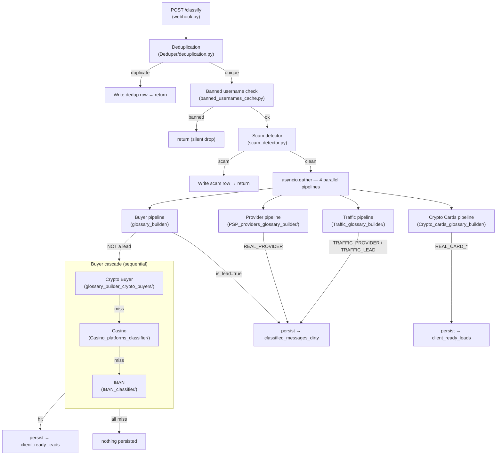

# Жизненный цикл запроса

## Обзор

Каждое сообщение из Telegram приходит как JSON на `POST /classify` и проходит
через цепочку: pre-classification фильтры → 4 параллельных пайплайна → запись
в PostgreSQL.

## Диаграмма



## Входной формат

```json
{
    "text": "Ищу PSP для iGaming, нужен KZ и RU, объём от 500k",
    "group_id": 123456789,
    "message_id": 42,
    "username": "user_handle",
    "timestamp": "2026-10-20T12:00:00Z",
    "context": [
        {"message_id": 41, "text": "предыдущее сообщение", "username": "other_user"}
    ]
}
```

Поле `context` — опциональное, содержит окружающие сообщения для buyer-пайплайна
(используется как контекст для LLM-классификации).

Определено в `ClassifyRequest` (Pydantic model) — [webhook.py:493](webhook.py#L493).

## Pre-classification фильтры

### 1. Дедупликация

**Файл:** [Deduper/deduplication.py](Deduper/deduplication.py)

Две проверки:
- **Time-based** — если тот же `username` отправил любое сообщение в последние
  3 минуты → duplicate
- **Text-based** — если тот же `username` отправил тот же текст (MD5 hash)
  за последние 24 часа → duplicate

Защита от race condition: PostgreSQL advisory lock по `username`.

Таблица: `dedup_log` (username PK, text_hash, created_at).

При дупликации: пишется строка в `classified_messages_dirty` с `pipeline="dedup"`,
`is_lead=false`. Обработка прекращается.

### 2. Бан-лист

**Файл:** [banned_usernames_cache.py](banned_usernames_cache.py)

In-memory кеш, загружается из:
- Файл `ignored_usernames.txt` (при старте)
- PostgreSQL (при старте)
- PostgreSQL LISTEN/NOTIFY (в реальном времени, async listener task)

При попадании: silent drop, ничего не пишется в БД.

### 3. Скам-детектор

**Файл:** [scam_detector.py](scam_detector.py)

Двухэтапный фильтр:
1. Keyword-матч — если ни одного ключевого слова нет → `False` (пропускаем, без LLM-вызова)
2. LLM бинарная классификация (`gpt-4o-mini` через OpenRouter) → `is_scam=0/1`

При `is_scam=1`: пишет строку в `classified_messages_dirty`, возвращает `True` →
обработка прекращается.

## Параллельные пайплайны

После прохождения pre-classification фильтров, сообщение отправляется в 4
пайплайна одновременно через `asyncio.gather` + `asyncio.to_thread`
(классификаторы синхронные, каждый запускается в отдельном треде).

Каждый пайплайн независим: они не знают о результатах друг друга,
не конфликтуют по данным, и одно сообщение может быть классифицировано
сразу несколькими пайплайнами (например, как buyer и как provider).

Код запуска: [webhook.py:1023](webhook.py#L1023) — `asyncio.gather(...)`.

Ошибка в одном пайплайне не блокирует остальные (`return_exceptions=True`).

## Каскад Buyer-пайплайна

Если buyer-пайплайн вернул `is_lead=false` или `verdict="MISTAKE"`, и запись
в БД прошла успешно (`db_write_status="ok"`), запускается каскад
из 3 суб-классификаторов **последовательно**:

1. **Crypto Buyer** → если `True` → stop
2. **Casino** → если `True` → stop
3. **IBAN** → если `True` → stop

Если ни один не сработал — сообщение остаётся как "not a lead" от buyer-пайплайна
(уже записано в БД на предыдущем шаге).

Каскад привязан к `source_lead_id` — ID записи buyer-пайплайна в
`classified_messages_dirty`, который передаётся суб-классификаторам для связки.

Код каскада: [webhook.py:1133](webhook.py#L1133).

## Персистенция

Каждый пайплайн имеет свою persist-функцию в `webhook.py`:

| Пайплайн | Функция | Целевая таблица | Условие записи |
|-----------|---------|-----------------|----------------|
| Buyer | `_persist_buyer()` | `classified_messages_dirty` | Всегда (и лиды, и не-лиды) |
| Provider | `_persist_provider()` | `classified_messages_dirty` | Только `is_provider=True` и `verdict != MISTAKE` |
| Traffic | `_persist_traffic()` | `classified_messages_dirty` | Только `verdict ∈ {TRAFFIC_PROVIDER, TRAFFIC_LEAD}` |
| Crypto Cards | `_persist_crypto_cards()` | `client_ready_leads` | Только `verdict ∈ {REAL_CARD_SEEKER, REAL_CARD_PROVIDER}` |
| Cascade | (внутри каждого классификатора) | `client_ready_leads` | Только при положительном вердикте |

Все persist-функции (кроме buyer) выполняют **cross-user text dedup** — проверяют,
есть ли уже такой же текст (MD5) с тем же `lead_type` в таблице. Если есть —
помечают как `[multiacc duplicate]` и не дублируют запись.

**Geo pipeline** — запускается внутри persist-функций (buyer, provider, traffic)
после classification, перед записью в БД. Нормализует, расширяет и дополняет
список гео-кодов. Подробнее: [docs/05-database-schema.md](05-database-schema.md).

## Startup (lifespan)

При запуске сервера (`lifespan()` в [webhook.py:287](webhook.py#L287)) загружаются:

1. **Buyer**: glossary JSON, RAG-индекс (ChromaDB), LLMClient, config (prompt v5-01-short, judge v2)
2. **Provider**: glossary из SQLite, LLMClient (отдельный OpenRouter key), ProviderExtractor
3. **Traffic**: glossary из SQLite, LLMClient (отдельный key), config
4. **Crypto Cards**: glossary из SQLite, LLMClient (отдельный key), config
5. **PostgreSQL** connection pool (asyncpg, 2-10 connections)
6. **Banned usernames cache** (файл + БД + LISTEN task)

Если RAG-индекс пуст — startup падает (`RuntimeError`).

## Ответ `/classify`

Endpoint всегда возвращает `200 OK` с пустым `{}` (fire-and-forget).
Вся обработка происходит внутри `asyncio.create_task(_run())` —
клиент не ждёт результата классификации.

Это значит, что парсер Telegram получает мгновенный ответ, а классификация
выполняется в фоне. Ошибки логируются, но не возвращаются клиенту.
