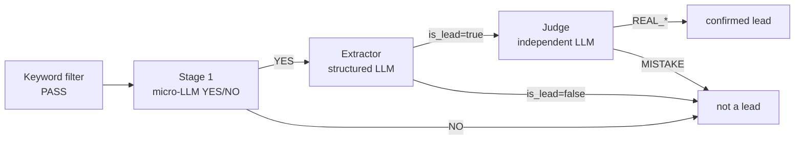

# Этапы 2-4: LLM-классификация

## Обзор

После keyword-фильтра (этап 1) сообщение проходит до трёх LLM-стадий:

1. **Stage 1 (Prefilter)** — дешёвый micro-LLM, отвечает YES/NO
2. **Extractor** — полная structured extraction: определяет тип лида и извлекает поля
3. **Judge** — независимая перепроверка решения extractor'а

Не все пайплайны используют все три стадии. Каждая стадия может быть
отключена через config (`stage1_enabled`, `judge_enabled`).

## Общая схема



## LLM-провайдеры

**Файл:** [glossary_builder/llm.py](../glossary_builder/llm.py)

`LLMClient` — универсальный враппер, поддерживает три провайдера:
- **Anthropic** — через `anthropic` SDK
- **OpenAI** — через `openai` SDK
- **OpenRouter** — через `openai` SDK с `base_url="https://openrouter.ai/api/v1"`

Выбор провайдера:
1. Env `GLOSSARY_PROVIDER` → если задан, выигрывает
2. `ANTHROPIC_API_KEY` → Anthropic
3. `OPENAI_API_KEY` → OpenAI

Каждый пайплайн может использовать свой `LLMClient` с отдельным API-ключом
и моделью. По умолчанию: `openai/gpt-4.1-mini` через OpenRouter.

Публичный API: `complete(system, user)` и `complete_json(system, user)`.

## Детали по пайплайнам

---

### Buyer pipeline

**Файлы:**
- [glossary_builder/single_classifier.py](../glossary_builder/single_classifier.py) — точка входа
- [glossary_builder/lead_extraction.py](../glossary_builder/lead_extraction.py) — LeadExtractor
- [glossary_builder/lead_prompt_versions.py](../glossary_builder/lead_prompt_versions.py) — промпты
- [glossary_builder/rag.py](../glossary_builder/rag.py) — RAG few-shot
- [glossary_builder/fusion.py](../glossary_builder/fusion.py) — FusionExtractor

**Stage 1:** Есть (`stage1_enabled=True`), но встроен в `LeadExtractor.extract_one()`.
Бинарный YES/NO buyer-intent screen.

**Extractor:** `LeadExtractor` — самый сложный из всех пайплайнов:
- **Glossary injection** — для каждого сообщения находит совпавшие термины
  из глоссария (substring match по surface forms) и вставляет их определения
  в системный промпт. Это «RAG на глоссарии» — LLM видит термин с определением.
- **Few-shot RAG** — извлекает k ближайших примеров из ChromaDB
  (k=2 LEAD + k=2 NOT_LEAD), вставляет в промпт. Embeddings: `perplexity/pplx-embed-v1-0.6b`.
- **Context** — до 5 предыдущих + 1 следующее сообщение из того же чата.
- **Lead definition** — версионированный промпт (текущий: `v5-01-short`),
  определяющий что считать лидом. Подробные критерии с примерами false positives.

Извлекаемые поля (→ `LeadDecision`):
- `is_lead`, `confidence`, `lead_type` (seeking_psp / seeking_method / seeking_acquiring / seeking_other)
- `intent` (buying / comparing / researching / complaining / other)
- `interest_level` (high / medium / low)
- `vertical[]`, `geo[]`, `payment_methods_mentioned[]`
- `evidence_quote`, `rationale`

**Judge:** Отдельный LLM-вызов (`_run_judge()`). Получает extractor'ный результат
и исходный текст, выдаёт:
- `verdict`: REAL_LEAD / MISTAKE / REVIEW (fallback)
- `reason`: однострочное пояснение

Промпт judge: версионированный (текущий: `v2`), хранится в
`JUDGE_PROMPTS_BY_VERSION` в [glossary_builder/cli.py](../glossary_builder/cli.py).
Содержит подробный список false positive паттернов.

---

### Provider pipeline

**Файлы:**
- [PSP_providers_glossary_builder/provider_classifier.py](../PSP_providers_glossary_builder/provider_classifier.py)
- [PSP_providers_glossary_builder/provider_prompt.py](../PSP_providers_glossary_builder/provider_prompt.py)
- [PSP_providers_glossary_builder/provider_decision.py](../PSP_providers_glossary_builder/provider_decision.py)

**Stage 1:** micro-LLM YES/NO — «Is this a seller?»
- Промпт: `_PROVIDER_STAGE1_SYSTEM` — примеры YES (provider voice) и NO (buyer, discussion, complaints)
- Одно слово в ответе: YES или NO
- NO → short-circuit, `is_provider=False`
- Модель: env `PROVIDER_STAGE1_MODEL` (default: та же что и основная)

**Extractor:** полный LLM-вызов с glossary injection
- Промпт: `_PROVIDER_SYSTEM_TEMPLATE` + `PROVIDER_DEFINITION`
- Context: до 3 предыдущих сообщений (меньше чем buyer — провайдеры обычно
  пишут standalone messages)
- Glossary injection: аналогично buyer, но с provider-specific терминами

Извлекаемые поля (→ `ProviderDecision`):
- `is_provider`, `confidence`
- `geo[]`, `methods[]`, `vertical[]`
- `company`, `position` (должность автора)
- `evidence_quote`, `rationale`

**Judge:** `_run_provider_judge()`
- Промпт: `_PROVIDER_JUDGE_SYSTEM` + `_PROVIDER_JUDGE_USER_TEMPLATE`
- `verdict`: REAL_PROVIDER / MISTAKE / REVIEW
- Модель: env `PROVIDER_JUDGE_MODEL`

---

### Traffic pipeline

**Файлы:**
- [Traffic_glossary_builder/traffic_classifier.py](../Traffic_glossary_builder/traffic_classifier.py)
- [Traffic_glossary_builder/traffic_prompt.py](../Traffic_glossary_builder/traffic_prompt.py)
- [Traffic_glossary_builder/traffic_decision.py](../Traffic_glossary_builder/traffic_decision.py)

**Stage 1:** micro-LLM YES/NO — «Is this a traffic message?»
- Промпт: `_TRAFFIC_STAGE1_SYSTEM`
- Модель: env `TRAFFIC_STAGE1_MODEL`

**Extractor:** structured extraction
- Промпт: `_TRAFFIC_SYSTEM_TEMPLATE` + `TRAFFIC_DEFINITION`
- Различает два типа: `traffic_provider` (продавец) и `seeking_traffic` (покупатель)

Извлекаемые поля (→ `TrafficDecision`):
- `is_lead`, `lead_type` (traffic_provider / seeking_traffic), `confidence` (high/medium/low)
- `vertical[]`, `traffic_source[]`, `geo[]`, `pricing_model[]`
- `evidence_quote`, `rationale`

**Judge:** `verdict`: TRAFFIC_PROVIDER / TRAFFIC_LEAD / MISTAKE
- Промпт: `_TRAFFIC_JUDGE_SYSTEM`
- **Verdict alignment check:** если `lead_type` extractor'а не совпадает с verdict
  judge'а, результат корректируется.
- Модель: env `TRAFFIC_JUDGE_MODEL`

---

### Crypto Cards pipeline

**Файлы:**
- [Crypto_cards_glossary_builder/crypto_cards_classifier.py](../Crypto_cards_glossary_builder/crypto_cards_classifier.py)
- [Crypto_cards_glossary_builder/crypto_cards_prompt.py](../Crypto_cards_glossary_builder/crypto_cards_prompt.py)
- [Crypto_cards_glossary_builder/crypto_cards_decision.py](../Crypto_cards_glossary_builder/crypto_cards_decision.py)

Использует нумерацию Stage 1 / Stage 3 / Stage 4 (Stage 2 — keyword filter).

**Stage 1:** micro-LLM YES/NO
- Промпт: `_CRYPTO_CARDS_STAGE1_SYSTEM`
- Модель: env `CRYPTO_CARDS_STAGE1_MODEL`

**Stage 3 (Extractor):** role-play LLM
- Промпт: `_CRYPTO_CARDS_STAGE3_SYSTEM` + `_CRYPTO_CARDS_STAGE3_USER`
- Различает: `card_seeker` и `card_provider`
- `confidence` имеет разную семантику:
  - card_seeker → `warmth` (насколько горячий лид)
  - card_provider → `overlap` (насколько прямой конкурент)

Извлекаемые поля (→ `CryptoCardsDecision`):
- `is_lead`, `lead_type`, `confidence` (high/medium/low)
- `evidence_quote`, `rationale`
- Нет `geo` в v1

**Stage 4 (Judge):**
- Промпт: `_CRYPTO_CARDS_STAGE4_SYSTEM` + `_CRYPTO_CARDS_STAGE4_USER`
- `verdict`: REAL_CARD_SEEKER / REAL_CARD_PROVIDER / MISTAKE
- `notes`: пояснение для BD-команды (пишется в `client_ready_leads.notes`)
- **Verdict alignment check:** аналогично Traffic
- Модель: env `CRYPTO_CARDS_JUDGE_MODEL`

---

### Cascade: Crypto Buyer

**Файлы:**
- [glossary_builder_crypto_buyers/crypto_buyer_classifier.py](../glossary_builder_crypto_buyers/crypto_buyer_classifier.py) (текущий)
- [Crypto_buyers_classifier/crypto_buyer_classifier.py](../Crypto_buyers_classifier/crypto_buyer_classifier.py) (старый, keyword-based)

Текущая реализация использует тот же `LeadExtractor` что и buyer, но с
другим glossary, промптами и domain data (`crypto_otc_buyers.py`).
Без RAG (пока нет достаточного количества примеров).

Pipeline: keyword filter → extract → judge (в рамках LeadExtractor).

---

### Cascade: Casino

**Файл:** [Casino_platforms_classifier/casino_classifier.py](../Casino_platforms_classifier/casino_classifier.py)

Двухстадийный LLM-pipeline:
1. LLM verification (`GLOSSARY_MODEL`) → `is_lead` true/false
2. LLM field extraction (`JUDGE_MODEL`) → verdict + geo, platform, vertical, notes

Без author-context — каждое сообщение классифицируется независимо.

---

### Cascade: IBAN

**Файл:** [IBAN_classifier/iban_lead_classifier.py](../IBAN_classifier/iban_lead_classifier.py)

Трёхстадийный LLM-pipeline:
1. Keyword filter (local)
2. LLM verification (`VERIFY_MODEL`) → is_buyer true/false
3. LLM field extraction (`EXTRACT_MODEL`) → vertical, currencies, current_provider, company, notes

Context: если есть username, подгружает до 10 предыдущих сообщений автора
из `client_ready_leads`.

---

## Сводная таблица

| | Buyer | Provider | Traffic | Crypto Cards | Crypto Buyer | Casino | IBAN |
|---|---|---|---|---|---|---|---|
| Stage1 | Да (встр.) | Да | Да | Да | Нет | Нет | Нет |
| Extractor | LeadExtractor + RAG + glossary injection | Structured + glossary | Structured | Role-play | LeadExtractor (без RAG) | LLM verify | LLM verify |
| Judge | Отдельный | Отдельный | Отдельный | Отдельный (Stage 4) | В extractor | LLM extract | LLM extract |
| Context | 5 before + 1 after | 3 before | Да | Нет | Нет | Нет | 10 prev (from DB) |
| Verdicts | REAL_LEAD / MISTAKE | REAL_PROVIDER / MISTAKE | TRAFFIC_PROVIDER / TRAFFIC_LEAD / MISTAKE | REAL_CARD_SEEKER / REAL_CARD_PROVIDER / MISTAKE | REAL_LEAD / MISTAKE | REAL_LEAD / stop | is_buyer / stop |

## Env-переменные (LLM-related)

```bash
# Buyer pipeline
GLOSSARY_PROVIDER=              # anthropic / openai (auto-detect if empty)
ANTHROPIC_API_KEY=              # для buyer LLM (если Anthropic)
OPENAI_API_KEY=                 # для buyer LLM (если OpenAI) + RAG embeddings
GLOSSARY_MODEL=claude-sonnet-4-5  # модель buyer extractor

# Provider pipeline
PSP_PROVIDERS_OPENROUTER_API_KEY=sk-or-...
PSP_PROVIDERS_MODEL=openai/gpt-4.1-nano      # основная модель
PROVIDER_STAGE1_MODEL=openai/gpt-4.1-mini    # Stage1 (optional override)
PROVIDER_JUDGE_MODEL=openai/gpt-4.1-mini     # Judge (optional override)

# Traffic pipeline
TRAFFIC_OPENROUTER_API_KEY=sk-or-...
TRAFFIC_STAGE1_MODEL=openai/gpt-4.1-mini
TRAFFIC_JUDGE_MODEL=openai/gpt-4.1-mini

# Crypto Cards pipeline
CRYPTO_CARDS_OPENROUTER_API_KEY=sk-or-...
CRYPTO_CARDS_STAGE1_MODEL=openai/gpt-4.1-mini
CRYPTO_CARDS_JUDGE_MODEL=openai/gpt-4.1-mini
```

## Ошибки и fallback

Все LLM-вызовы обёрнуты в try/except:
- Stage 1: ошибка → пропускаем stage1, сообщение идёт в extractor
- Extractor: ошибка → `is_lead=False`, `rationale="extraction failed: {exc}"`
- Judge: ошибка → `verdict="REVIEW"`, `judge_reason="judge call failed: {exc}"`

`REVIEW` — fallback verdict, когда модель вернула что-то неожиданное
или вызов упал. Не является ни подтверждением, ни отклонением.
